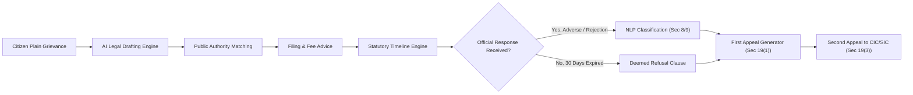

# 🏛️ RTI Assist — Comprehensive Project & System Specification

> **A Complete Context Document for Engineers, Collaborators, Evaluators, and Large Language Models (LLMs)**  
> *Under the Right to Information Act, 2005 (Government of India)*

---

## 📋 Table of Contents
1. [Project Overview & Core Mission](#1-project-overview--core-mission)
2. [What We Are Doing (The Functional Domain)](#2-what-we-are-doing-the-functional-domain)
   - [The Citizen Journey](#the-citizen-journey)
   - [Statutory Rules & Deadlines (RTI Act 2005)](#statutory-rules--deadlines-rti-act-2005)
3. [How We Are Doing It (Architecture & Technology Stack)](#3-how-we-are-doing-it-architecture--technology-stack)
   - [Monorepo Directory Structure](#monorepo-directory-structure)
   - [Service Topology & Communication](#service-topology--communication)
   - [Component Deep-Dive](#component-deep-dive)
4. [Zero-Crash AI Fallback Engine](#4-zero-crash-ai-fallback-engine)
5. [Complete API Endpoints & Interfaces](#5-complete-api-endpoints--interfaces)
6. [Data Schema & Storage](#6-data-schema--storage)
7. [Running & Developing the Project](#7-running--developing-the-project)
8. [Guide for Downstream LLMs & AI Agents](#8-guide-for-downstream-llms--ai-agents)
9. [Project Provenance & Authors](#9-project-provenance--authors)

---

## 1. Project Overview & Core Mission

**RTI Assist** is an end-to-end, full-stack civic technology platform engineered to simplify, automate, and democratize the process of filing and managing **Right to Information (RTI)** applications in India under the **RTI Act, 2005**.

### The Problem
- **Complex Legal Phrasing**: Citizens frequently draft vague, inquisitive queries (e.g., *"Why has my road not been built?"*) which public authorities legally reject under Section 2(f), because RTI only permits requests for identifiable records, documents, memos, and logs.
- **Wrong Authority Routing**: Applications are often sent to the wrong department or Public Information Officer (PIO), causing weeks of delay or outright rejection.
- **Missed Statutory Deadlines**: Citizens are unaware of their legal rights when authorities fail to reply within 30 calendar days (or 48 hours for Life & Liberty).
- **Intimidating Appeal Process**: Filing First and Second Appeals requires specific legal structure, grounds of appeal, and statutory citation.

### The Solution
RTI Assist transforms raw citizen complaints into legally sound, formatted RTI petitions, routes them to the correct Public Authority, tracks statutory deadlines with automated countdown timers, and drafts structured First Appeals if the government delays or unlawfully rejects the request.

---

## 2. What We Are Doing (The Functional Domain)

### The Citizen Journey
$$\text{Citizen Grievance} \xrightarrow{\text{AI Wizard}} \text{Legal Petition} \xrightarrow{\text{Authority Match}} \text{Official Filing} \xrightarrow{\text{Deadline Engine}} \text{Appeal Generator}$$



1. **Intake & Legal Rephrasing**:
   - The user inputs their grievance in colloquial English or Hinglish.
   - The AI converts narrative complaints into objective, legally admissible information points under Section 6(1) requesting certified copies, inspection of records, dispatch registers, and tender documents.
2. **Public Authority Recommendation**:
   - Matches the grievance against Central and State ministries (e.g., CPWD, MCD, Delhi Jal Board, NHAI, Ministry of Railways).
   - Surfaces PIO (Public Information Officer) and FAA (First Appellate Authority) designations, portal URLs (rtionline.gov.in), and fee structures.
3. **Statutory Timeline & Countdown Engine**:
   - Calculates strict legal expiry dates from the moment of filing.
   - Triggers reminders and visual status indicators (Active, Due Soon, Overdue, Appealed).
4. **Response Ingestion & Exemption Classification**:
   - When an official response is uploaded/pasted, the system scans for Section 8 exemptions (national security, commercial confidence, personal privacy, judicial contempt) or Section 9 copyright restrictions.
5. **Appeal Generator**:
   - If an application is rejected or ignored past the deadline (deemed refusal), the system auto-generates a formal **First Appeal Memo** to the First Appellate Authority under Section 19(1).

### Statutory Rules & Deadlines (RTI Act 2005)

| Section | Description | Statutory Timeframe |
|---|---|---|
| **Section 6(1)** | Standard citizen request for official records | N/A (Filing stage) |
| **Section 7(1)** | General Public Information Officer (PIO) response window | **30 calendar days** |
| **Section 7(1) Proviso** | Information concerning **Life or Liberty** of a person | **48 hours** |
| **Section 7(2)** | Failure to decide within timeline constitutes **Deemed Refusal** | On Day 31 (or hour 49) |
| **Section 19(1)** | **First Appeal** to designated Senior Officer / FAA | Within **30 days** of deadline expiry |
| **Section 19(3)** | **Second Appeal** to Central / State Information Commission (CIC/SIC) | Within **90 days** from First Appeal order |

---

## 3. How We Are Doing It (Architecture & Technology Stack)

### Monorepo Directory Structure

```text
rti-assist/
├── rti-assist-frontend/           # React 19 + TypeScript + Vite + Tailwind CSS v4
│   ├── src/
│   │   ├── components/            # UI components, layout, dialogs, timeline
│   │   ├── pages/                 # Landing, About, Intake, Dashboard, CaseView, Appeals
│   │   ├── services/              # API clients & mock data adapter
│   │   └── types/                 # TypeScript type definitions
│   ├── public/                    # Static assets & creator audio notes
│   ├── package.json
│   └── vite.config.js
│
├── rti-assist-backend/            # Java Spring Boot 3.4.2 REST API Server
│   ├── src/main/java/org/rtiassist/
│   │   ├── config/                # DotenvConfig, JwtUtil, WebConfig (CORS)
│   │   ├── controller/            # Ai, Appeal, Auth, Authority, Case, Deadline, Root
│   │   ├── dto/                   # Request & Response data transfer objects
│   │   ├── exception/             # GlobalExceptionHandler, ApiException
│   │   ├── model/                 # CaseItem, Authority, Deadline, Appeal, User
│   │   ├── repository/            # JsonDataStore (Thread-safe JSON persistence)
│   │   └── service/               # GeminiService (AI gateway + fallback), BrevoService (Email OTP)
│   ├── data/                      # Local JSON persistence storage (db.json)
│   ├── pom.xml                    # Maven build configuration (Java 21/23)
│   └── .env
│
├── rti-assist-llm-service/        # Node.js + Express legal NLP microservice
│   ├── src/
│   │   ├── index.js               # Microservice REST endpoints
│   │   └── promptTemplates.js     # RTI legal prompts for Gemini
│   ├── package.json
│   └── .env
│
├── .gitignore
├── README.md
└── PROJECT_CONTEXT.md             # This document
```

### Service Topology & Communication

```
                  ┌────────────────────────────────────────┐
                  │      React 19 Frontend (Vite)          │
                  │        http://localhost:5173           │
                  └───────┬────────────────────────┬───────┘
                          │                        │
         REST API calls   │                        │  Direct Legal NLP calls
      (Auth, Cases, CRUD) │                        │  (Classify & Draft)
                          ▼                        ▼
      ┌─────────────────────────┐    ┌─────────────────────────┐
      │ Java Spring Boot 3.4.2  │    │  Node.js LLM Service    │
      │        Backend          │    │      Microservice       │
      │  http://localhost:8000  │    │  http://localhost:8001  │
      └───────────┬─────────────┘    └─────────────┬───────────┘
                  │                                │
                  ├────────────────────────────────┤
                  ▼                                ▼
     ┌────────────────────────┐       ┌────────────────────────┐
     │    Google Gemini AI    │       │     Brevo Email API    │
     │ (gemini-3.1-flash-lite)│       │ (Transactional OTPs)   │
     └────────────────────────┘       └────────────────────────┘
```

### Component Deep-Dive

#### 1. Frontend (`rti-assist-frontend`)
- **Framework**: React 19 + TypeScript.
- **Build Tool**: Vite 8 with Hot Module Replacement (HMR).
- **Styling**: Tailwind CSS v4 + Lucide React icon set.
- **Routing**: React Router DOM v7.
- **Interactive UI**:
  - Multi-step interactive RTI filing intake wizard.
  - Case tracking timeline with statutory milestone flags.
  - Interactive mascot portfolio avatar with gaze tracking and speech synthesis.
  - Dark / Light / System theme support with CSS variable scoping.
- **Mock Mode**: Supports offline demonstration mode via `VITE_USE_MOCK=true` when backend is not running.

#### 2. Backend (`rti-assist-backend`)
- **Runtime**: Java 23 / Spring Boot 3.4.2.
- **Architecture**: Clean MVC with Controller-Service-Repository pattern.
- **Authentication**: JWT token issuance and verification + Email OTP validation using Brevo Transactional Email API.
- **Persistence**: `JsonDataStore` — a fast, zero-dependency, thread-safe JSON document store with atomic writes and automatic seed data initialization (authorities, sample cases, deadlines).
- **Statutory Deadline Engine**: Automatically populates 30-day and 48-hour legal milestones upon case creation.

#### 3. LLM Microservice (`rti-assist-llm-service`)
- **Runtime**: Node.js 22 + Express 4.
- **Function**: Dedicated legal classification service for official government replies, identifying:
  - Full grant, partial grant, or complete refusal.
  - Specific exemption clauses invoked (Sections 8(1)(a) through 8(1)(j)).
  - Whether grounds exist for Section 19(1) First Appeal.

---

## 4. Zero-Crash AI Fallback Engine

A core engineering tenet of RTI Assist is **Zero-Crash Resiliency**:
- The platform never crashes or blocks citizen workflows if the Google Gemini API key is missing, network access is down, or API rate limits (HTTP 429) are reached.
- Both the Java Backend (`GeminiService.java`) and the Node.js Microservice implement **Statutory Rule-Based Heuristic Fallbacks**:
  - **Drafting Fallback**: Analyzes keywords in the citizen concern (e.g., roads, electricity, exam, tender, pension) and constructs Section 6(1) compliant structured questions using verified legal templates.
  - **Authority Matching Fallback**: Pattern-matches entities (e.g., "MCD", "Jal Board", "UPSC", "Police", "Railway") against the pre-seeded public authority directory.
  - **Appeal Drafting Fallback**: Automatically drafts a First Appeal citing Section 19(1) and deemed refusal under Section 7(2).

---

## 5. Complete API Endpoints & Interfaces

### Java REST Backend (`http://localhost:8000`)

| Method | Endpoint | Description | Auth Required |
|---|---|---|:---:|
| `GET` | `/` | System status, framework info, database counts | No |
| `GET` | `/api/health` | Health check endpoint | No |
| `POST` | `/api/auth/send-otp` | Sends numeric verification OTP to user email | No |
| `POST` | `/api/auth/verify-otp` | Verifies OTP and returns signed JWT token | No |
| `POST` | `/api/auth/login` | Email/password authentication | No |
| `POST` | `/api/auth/check-email`| Checks if email already exists in system | No |
| `GET` | `/api/cases` | Retrieves list of all citizen cases | Optional |
| `POST` | `/api/cases` | Creates a new RTI case with computed deadlines | Optional |
| `GET` | `/api/cases/{id}` | Retrieves full case detail and timeline | Optional |
| `POST` | `/api/cases/{id}/response` | Records government reply & triggers classification | Optional |
| `GET` | `/api/authorities` | Lists supported Public Authorities (with filters) | No |
| `GET` | `/api/deadlines` | Lists active statutory deadlines | Optional |
| `POST` | `/api/draft-request` | AI / heuristic drafting of legal RTI questions | No |
| `POST` | `/api/recommend-authority` | Recommends appropriate public department | No |
| `POST` | `/api/draft-appeal` | Generates formal First Appeal text | No |

### LLM Microservice (`http://localhost:8001`)

| Method | Endpoint | Description |
|---|---|---|
| `GET` | `/` or `/health` | Service status and Gemini configuration check |
| `POST` | `/classify-response` | Classifies government replies & checks exemptions |
| `POST` | `/draft-request` | Direct legal rephrasing endpoint |
| `POST` | `/recommend-authority` | Direct authority suggestion endpoint |
| `POST` | `/draft-appeal` | Direct appeal generation endpoint |

---

## 6. Data Schema & Storage

### Case Schema (`CaseItem`)
```json
{
  "id": "case_1729000000000",
  "userId": "usr_demo",
  "title": "Repair of Potholed Road in Rohini Sector 15",
  "concern": "The main sector road has large potholes causing accidents for 6 months.",
  "generatedDraft": "Under Section 6(1) of the RTI Act, 2005, please provide...",
  "authorityId": "auth_mcd",
  "filingDate": "2026-10-15T00:00:00Z",
  "lifeOrLiberty": false,
  "status": "FILED",
  "deadlines": {
    "pioDeadline": "2026-11-14T00:00:00Z",
    "firstAppealDeadline": "2026-12-14T00:00:00Z"
  },
  "officialResponse": null,
  "documents": []
}
```

### Public Authority Schema (`Authority`)
```json
{
  "id": "auth_mcd",
  "name": "Municipal Corporation of Delhi (MCD)",
  "department": "Engineering & Public Health",
  "level": "State / Municipal",
  "portalUrl": "https://mcdonline.nic.in",
  "feeAmount": 10,
  "pio": {
    "designation": "Public Information Officer",
    "address": "Civic Centre, Minto Road, New Delhi - 110002"
  },
  "faa": {
    "designation": "First Appellate Authority / Superintending Engineer",
    "address": "Civic Centre, New Delhi - 110002"
  }
}
```

---

## 7. Running & Developing the Project

### Prerequisites
- **Node.js**: v18+ or v22+
- **Java**: JDK 21 or JDK 23
- **Maven**: Pre-packaged via `mvnw.cmd` / `mvnw`

### Quick Start Commands

#### 1. Java Spring Boot Backend (Port 8000)
```bash
cd rti-assist-backend
# Run pre-compiled JAR directly (fastest):
java -jar target/rti-assist-backend-0.0.1-SNAPSHOT.jar

# Or compile and run with Maven:
.\mvnw.cmd spring-boot:run
```

#### 2. Dedicated LLM Microservice (Port 8001)
```bash
cd rti-assist-llm-service
node src/index.js
```

#### 3. React Frontend Dev Server (Port 5173)
```bash
cd rti-assist-frontend
node .\node_modules\vite\bin\vite.js --host
```

---

## 8. Guide for Downstream LLMs & AI Agents

When interacting with or extending this codebase, keep these rules in mind:

1. **Dual AI Gateway Strategy**:
   - The Java Backend handles full application logic, authentication, and core AI drafting via `GeminiService.java`.
   - The Node.js LLM service provides specialized classification.
   - Always ensure both services maintain identical fallback capabilities if modifying prompt structures.
2. **Statutory Integrity**:
   - Never alter the statutory calculation rules (30 days for general PIO response under Section 7(1), 48 hours for Life & Liberty).
   - All appeals must adhere to Section 19(1) for First Appeal and Section 19(3) for Second Appeal.
3. **Frontend Mock Switch**:
   - In `rti-assist-frontend/.env`, `VITE_USE_MOCK=false` connects directly to the live backend on port 8000. Set to `true` only for offline client-only demo builds.
4. **Data Persistence**:
   - Persistent data is stored in `rti-assist-backend/data/db.json`. When testing new records, verify against the atomic write behavior in `JsonDataStore.java`.

---

## 9. Project Provenance & Authors

Developed as the **B.Tech Computer Science & Engineering (Semester 7) Major Project** at **Delhi Skill and Entrepreneurship University (DSEU)**, Okhla-II Campus, New Delhi.

- **Yash Sehgal** ([@idarkpearl](https://github.com/idarkpearl)) — Project Lead & Full-Stack Engineer  
  *Responsibilities: Frontend Architecture, REST API Design, UI/UX Engineering, Auth Pipeline.*
- **Prachi Mehra** ([@prachi1862](https://github.com/prachi1862)) — Systems & Backend Engineer  
  *Responsibilities: Java Spring Boot Services, Data Architecture, Statutory Deadline Engine, Fallback Heuristics.*

---
*Document generated for project handoff, technical evaluation, and autonomous AI context.*
